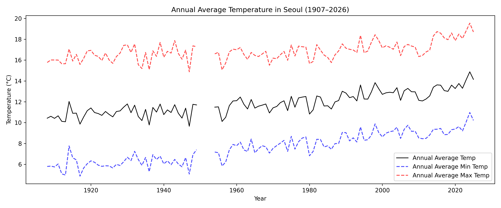
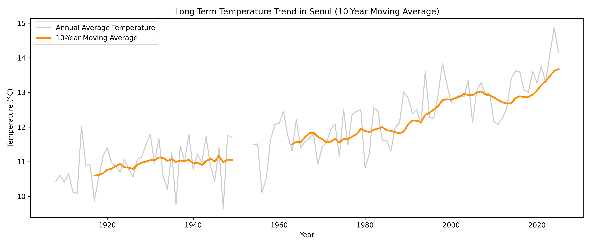
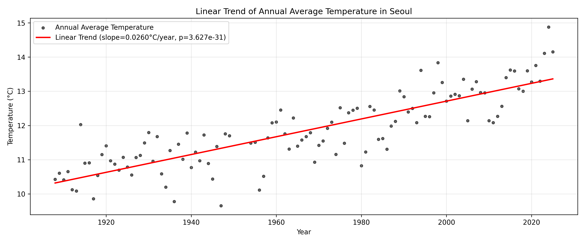
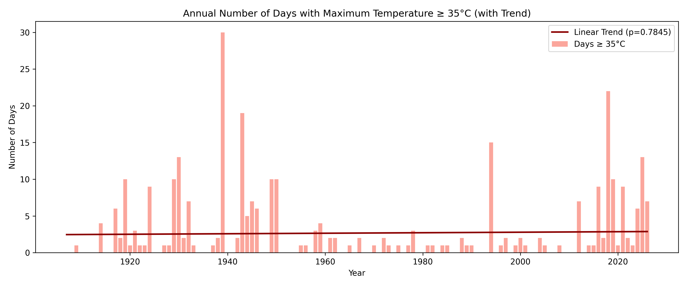
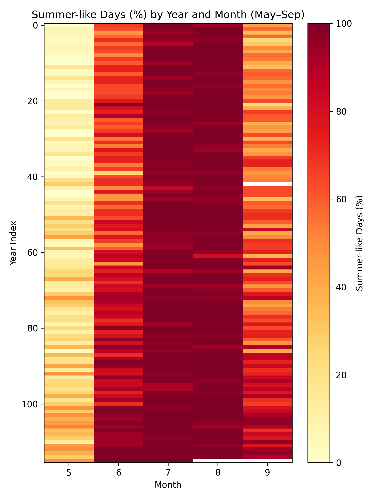
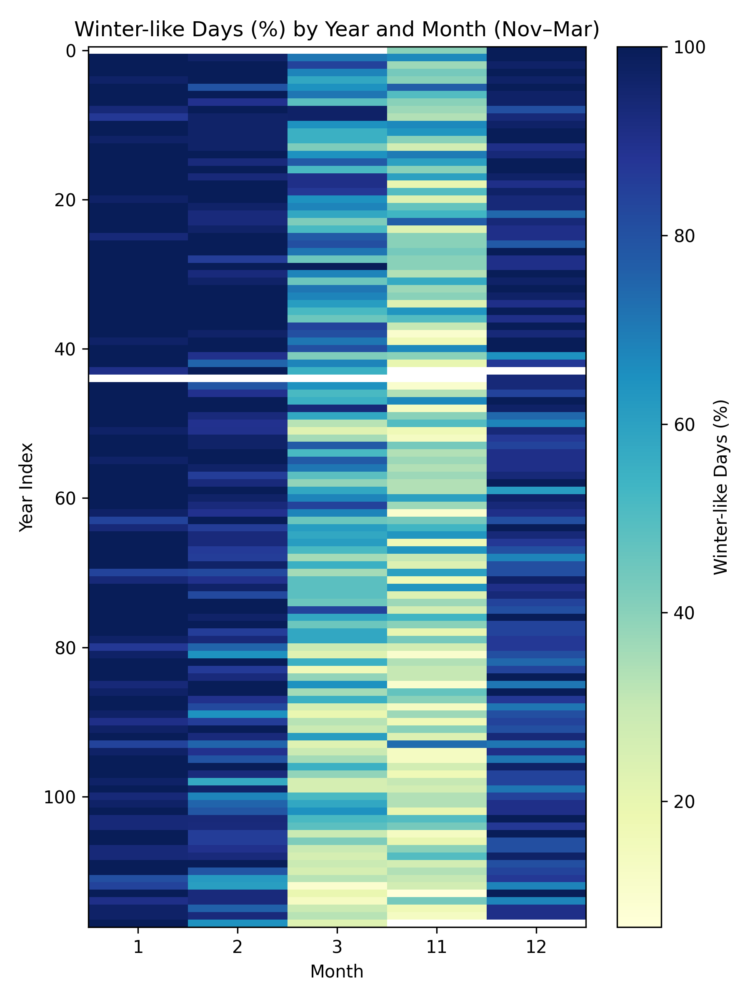
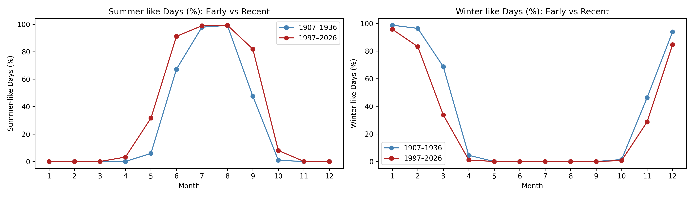
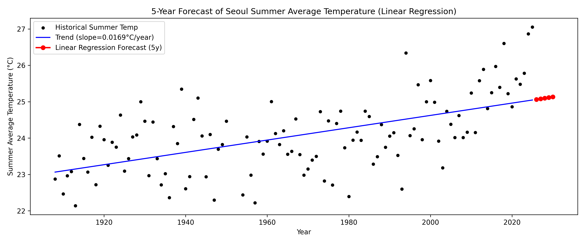
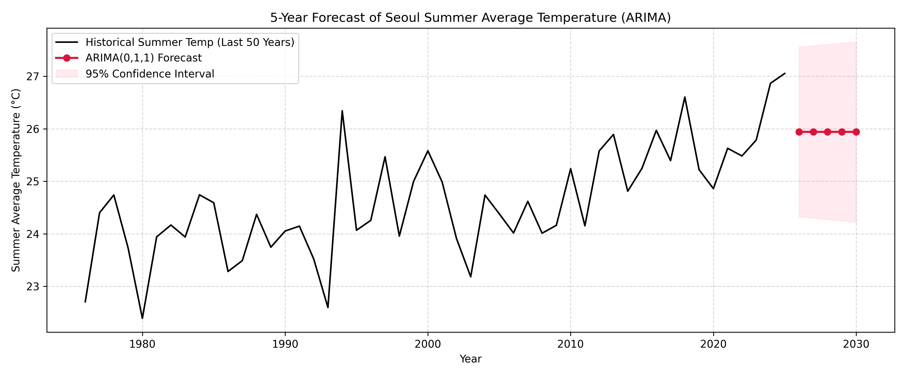

# Time Series Data Analysis Report

## 1. Research Topic & Motivation

* **Topic:** Identification of long-term warming trends, diagnosis of seasonal expansion and contraction patterns, and forecasting of average summer temperatures for the next five years (2026–2030) using daily temperature observation time-series data in Seoul over the past 120 years (1907–2026).
* **Motivation:** 
  1. **Accelerating Climate Crisis and Urban Heat Island (UHI) Effect:** Seoul has undergone rapid industrialization and urbanization. As a major metropolitan area where global warming and local Urban Heat Island (UHI) effects overlap, its temperature rise is exceptionally pronounced.
  2. **Over a Century of Continuous Public Meteorological Data:** The Seoul Weather Station (Station ID 108) of the Korea Meteorological Administration (KMA) has accumulated over 110 years of daily meteorological observations since 1907, providing an ideal dataset for long-term climate time-series analysis free from distortion by short-term volatility.
  3. **Informing Heatwave and Climate Adaptation Policies:** Beyond tracking simple annual mean warming, this study examines shifts in seasonal onset and end dates (seasonal expansion/contraction), trends in extreme heat days (tmax ≥ 35°C), and future temperature projections. This provides actionable, data-driven evidence for power grid demand planning, protecting vulnerable populations from extreme heat, and formulating urban disaster resilience policies.

---

## 2. Research Questions

1. **Forecasting Seoul's Average Summer Temperatures for the Next 5 Years (2026–2030):** Based on historical summer (June–August) average temperature time-series data, how will summer temperatures trend over the next five years?
2. **Analyzing Long-Term Warming Trends and Extreme Heat Days (Daily Maximum Temperature ≥ 35°C):** Do annual mean, summer, and winter temperatures in Seoul exhibit statistically significant upward trends? Are extreme heat days (≥35°C) also increasing in the long run?
3. **Evaluating Asymmetric Seasonal Warming (Summer vs. Winter):** Are warming rates (per year / per 100 years) equal between summer and winter, or is there an asymmetric warming dynamic where one season warms significantly faster?
4. **Identifying Physical Temperature-Based Seasonal Boundary Shifts (Expansion & Contraction):** Do transition months (May & September, November & March) show empirical evidence of an earlier onset / delayed conclusion of summer and a contraction of winter?

---

## 3. Dataset Description

- **Source:** Korea Meteorological Administration (KMA) Weather Data Service – Automated Synoptic Observing System (ASOS) data ([data.kma.go.kr](https://data.kma.go.kr/))
- **Observation Station:** Seoul (Station ID 108; Seoul Weather Station, 52 Songwol-gil, Jongno-gu, Seoul)
- **Observation Period:** October 1, 1907 – August 19, 2026 (~120 years)
- **Number of Observations:** 42,236 records (daily observation records)
- **Key Columns:** (English column names created to prevent character encoding issues)
  - `date`: Observation date (YYYY-MM-DD)
  - `tavg`: Daily average temperature (°C)
  - `tmin`: Daily minimum temperature (°C)
  - `tmax`: Daily maximum temperature (°C)
  - Derived variables: `year`, `month`, `day`, `day_of_year`, `season_year`, `season`, `summer_like`, `winter_like`, `over_35`, `warm_day`, `hot_day`, `cold_day`
- **Data Collection Method:** Downloaded as a CSV file from the KMA Weather Data Service by selecting station 108 (Seoul), the entire observation period, and target weather elements (average, minimum, and maximum temperature), then saved to the project directory.
- **License / Terms of Use:** Korea Open Government License (KOGL) Type 1 (Free commercial and non-commercial reuse with attribution)
- [Detailed Data Documentation](./data/README_en.md)

---

## 4. Data Cleaning & Preprocessing

### 4.1 Basic Information

* **Raw Data Dimensions:** 42,236 rows × 6 columns (`station_ID`, `location`, `date`, `tavg`, `tmin`, `tmax`)
* **Type Conversion & Feature Engineering:**
  * Converted the date format (`DD/MM/YYYY` string) to standard `datetime64[ns]`, and extracted derived time-series features (`year`, `month`, `day`, `day_of_year`, `season_year`, `season`).
  * Engineered binary flags and indicators: `summer_like` (tavg ≥ 20°C), `winter_like` (tavg ≤ 5°C), `over_35` (tmax ≥ 35°C), `warm_day` (25 ≤ tmax < 30°C), `hot_day` (30 ≤ tmax < 35°C), `cold_day` (tmax ≤ 10°C & tmin < 0°C).
  * Removed uninformative single-station metadata columns (`station_ID` fixed at 108, `location` fixed at 'seoul') to streamline the data structure.
  * Confirmed dataset integrity: 0 duplicate records and 0 duplicate dates across the entire dataset.

### 4.2 Missing Values

* **Missing Value Status:**
  * Record-level column missingness: `tmin` has 2 missing values (1967-02-19 / 2022-08-08), `tmax` has 2 missing values (1967-02-19 / 2017-10-12). `tavg` has 0 missing values across all 42,236 rows.
  * Period-level continuous missingness: September 1, 1950 – November 30, 1953 (observation hiatus during the Korean War, ~3 years and 3 months).
* **Handling Strategy:**
  * The 2 daily missing values in `tmin` and `tmax` were retained as `NaN` to avoid introducing distortion through artificial interpolation, and handled via `dropna()` on an as-needed basis during specific analyses.
  * For the multi-year observation gap during the Korean War, arbitrary statistical interpolation was avoided. During annual aggregation and continuous time-series modeling (e.g., ARIMA), the missing years were appropriately excluded or partitioned to prevent analytical distortion.
  * Because most analyses were conducted using `tavg`, missing values in `tmin` and `tmax` posed no issues. For the linear regression and ARIMA models, rows corresponding to 1951–1953 and 2026 were dropped.
  * Primarily using daily mean temperature (`tavg`) avoided missingness issues associated with `tmin` and `tmax`. For linear regression and ARIMA models, data rows from 1950–1953, 1907, and 2026 with unobserved periods were dropped. Prior to modeling, dedicated model DataFrames were prepared via `dropna()` before running the analysis.

### 4.3 Outlier Detection

* **Outlier Detection Method (IQR Technique):**
  * Computed outlier thresholds for daily mean temperature (`tavg`), daily minimum temperature (`tmin`), and daily maximum temperature (`tmax`) using the $1.5 \times \text{IQR}$ rule (corresponding to approximately a 99.3% confidence interval under a normal distribution).
  * Detection results:
    * `tavg`: Q1 = 2.80°C, Q3 = 21.30°C, IQR = 18.50°C $\rightarrow$ Lower bound -24.95°C, Upper bound 49.05°C (0 outliers)
    * `tmin`: Q1 = -1.30°C, Q3 = 17.20°C, IQR = 18.50°C $\rightarrow$ Lower bound -29.05°C, Upper bound 44.95°C (0 outliers)
    * `tmax`: Q1 = 7.40°C, Q3 = 26.30°C, IQR = 18.90°C $\rightarrow$ Lower bound -20.95°C, Upper bound 54.65°C (0 outliers)
* **Outlier Handling Policy:** Historical extremes—such as the all-time minimum temperature of -23.1°C (1927-12-31) and all-time maximum temperature of 39.6°C (2018-08-01)—fall entirely within physically and meteorologically plausible observation boundaries. Because they reflect authentic meteorological phenomena rather than entry errors, 100% of the raw observations were retained without truncation or removal.

---

## 5. Time Series Analysis

### 5.1 Moving Average

* **Overview & Purpose:** A 10-year Moving Average was applied to smooth out short-term meteorological noise caused by interannual oscillations (El Niño/La Niña, volcanic activity, solar cycles, etc.) and clearly isolate the underlying long-term baseline trend.
* **Findings:** While the moving average hovered around 10.5°C in the early 1900s, it surged sharply upward after the 1970s–1980s, climbing steadily above 13.5°C in the 2020s, corroborating a pronounced structural warming trend.

### 5.2 Linear Regression Analysis

* **Overview & Purpose:** With year (`year` or `season_year`) as the independent variable and temperature metrics as dependent variables, Ordinary Least Squares (OLS) regression was conducted to quantitatively determine annual rates of change (Slope, in °C/year and °C/100 years), coefficient of determination ($R^2$), and statistical significance ($p$-value).
* **Key Results:**
  * **Annual Mean Temperature:** Slope $+0.0260^\circ\text{C}/\text{year}$ ($R^2 = 0.701$, $p = 3.63 \times 10^{-31}$, rising approx. $+2.60^\circ\text{C}$ per 100 years)
  * **Summer Mean Temperature:** Slope $+0.0169^\circ\text{C}/\text{year}$ ($R^2 = 0.327$, $p = 2.49 \times 10^{-11}$, rising approx. $+1.69^\circ\text{C}$ per 100 years)
  * **Winter Mean Temperature:** Slope $+0.0290^\circ\text{C}/\text{year}$ ($R^2 = 0.342$, $p = 5.68 \times 10^{-12}$, rising approx. $+2.90^\circ\text{C}$ per 100 years)

### 5.3 Mann-Kendall Trend Test and Sen's Slope

* **Overview & Purpose:** To validate trend significance robustly against non-normality and extreme variations in weather time series, the non-parametric Mann-Kendall test was applied alongside median-based Sen's Slope estimation.
* **Key Results:**
  * Strong monotonic increasing trends were verified at a significance level exceeding 99.9% for Annual Mean Temperature ($\text{Sen's Slope} = +0.0272^\circ\text{C}/\text{yr}, p < 0.001$), Summer Mean Temperature ($\text{Sen's Slope} = +0.0175^\circ\text{C}/\text{yr}, p = 6.79 \times 10^{-10}$), and Winter Mean Temperature ($\text{Sen's Slope} = +0.0300^\circ\text{C}/\text{yr}, p = 2.23 \times 10^{-10}$).
  * In contrast, extreme heat days ($\ge 35^\circ\text{C}$) yielded $p = 0.475$ and $\text{Sen's Slope} = 0.0$, indicating no statistically significant monotonic trend (No Trend).

### 5.4 Seasonal Transition Month Expansion Analysis

* **Overview & Purpose:** Beyond calendar seasons (June–August, December–February), changes in the proportions of spring/autumn transition months (May, September) and early winter/early spring transition months (November, March) were evaluated using physical temperature thresholds: $\text{tavg} \ge 20^\circ\text{C}$ ("summer-like days") and $\text{tavg} \le 5^\circ\text{C}$ ("winter-like days").
* **Key Results:**
  * **May (Early Summer Expansion):** Increase in summer-like days at $+29.41\%p/\text{100yr}$ ($R^2 = 0.505, p = 4.31 \times 10^{-19}$, $\text{Increasing}$, $\text{Sen's Slope} = +0.2867\%p/\text{yr}$)
  * **September (Late Summer Expansion):** Increase in summer-like days at $+36.58\%p/\text{100yr}$ ($R^2 = 0.504, p = 9.81 \times 10^{-19}$, $\text{Increasing}$, $\text{Sen's Slope} = +0.3865\%p/\text{yr}$)
  * **November (Winter Contraction):** Decrease in winter-like days at $-18.22\%p/\text{100yr}$ ($R^2 = 0.142, p = 3.26 \times 10^{-5}$, $\text{Decreasing}$, $\text{Sen's Slope} = -0.1812\%p/\text{yr}$)
  * **March (Winter Contraction):** Decrease in winter-like days at $-38.17\%p/\text{100yr}$ ($R^2 = 0.420, p = 3.66 \times 10^{-15}$, $\text{Decreasing}$, $\text{Sen's Slope} = -0.4032\%p/\text{yr}$)

### 5.5 Summer Temperature Forecasting Based on ARIMA and Linear Regression

* **Overview & Purpose:** Based on 118 years of historical summer average temperature records, stationarity was established via first-order differencing following ADF unit root testing. Subsequently, a linear regression trend model and an $\text{ARIMA}(0,1,1)$ model capturing short-term autocorrelation were built to forecast temperatures for the 5-year period (2026–2030) alongside 95% prediction intervals.
* **Model Performance Evaluation (5-Year Backtesting, 2021–2025):**
  * Linear Regression: $\text{MAE} = 1.370^\circ\text{C}$, $\text{RMSE} = 1.513^\circ\text{C}$
  * $\text{ARIMA}(0,1,1)$: $\text{MAE} = 0.959^\circ\text{C}$, $\text{RMSE} = 1.164^\circ\text{C}$ (ARIMA showed superior short-term predictive accuracy)
* **5-Year Future Forecast:** Summer average temperatures for 2026–2030 are projected to sustain an elevated level of approximately $25.94^\circ\text{C}$ (95% confidence interval: approx. $24.22^\circ\text{C} \sim 27.65^\circ\text{C}$), well above historical climate normals.

---

## 6. Analysis Results & Visualizations

### 6.1 Visualization 1: Annual Temperature History

* **Observations & Interpretation:**
  * Illustrates the long-term trajectories of Seoul's annual average temperature (black), annual average minimum temperature (blue), and annual average maximum temperature (red) from 1907 to 2026.
  * In the early 20th century (1910s–1930s), the annual average temperature was situated around 10–11°C, but accelerated upward after the 1970s–1980s, reaching 13–14.8°C by the 2020s.
  * In particular, the increase in annual average minimum temperature (climbing from ~5°C to above 10°C) is significantly steeper than that of annual average maximum temperature, reflecting suppressed nocturnal cooling (Urban Heat Island effect) resulting from urbanization.

### 6.2 Visualization 2: Annual Temperature 10-Year Moving Average Trend

* **Observations & Interpretation:**
  * Contrasts annual irregular year-to-year fluctuations (light gray) against the 10-year moving average curve (solid orange line), bringing long-term structural shifts into sharp focus.
  * Prior to the 1960s, the 10-year moving average fluctuated gently within the 10.5–11.5°C range, before initiating a steep upward climb starting in the 1970s–1980s.
  * By the 2020s, the 10-year moving average has surpassed 13.5°C, visually confirming a baseline warming of approximately 2.0–3.0°C over the past century.

### 6.3 Visualization 3: Annual Temperature Linear Regression Trendline

* **Observations & Interpretation:**
  * Linear regression of annual average temperature against time yielded a slope of $+0.0260^\circ\text{C}/\text{year}$ ($p = 3.63 \times 10^{-31}$, $R^2 = 0.701$).
  * This represents an extraordinarily rapid warming rate of approximately $+2.60^\circ\text{C}$ per century, which is statistically significant.
  * Compared to global average warming rates (~1.0–1.2°C per century) and national warming across South Korea (~1.6–1.9°C per century), Seoul is warming roughly 2.2 to 2.6 times faster, exemplifying the coupled impact of global climate change and urban heat island effects.

### 6.4 Visualization 4: Annual Days Over 35°C Trend

* **Observations & Interpretation:**
  * Depicts the annual count of extreme heat days with daily maximum temperature ≥ 35°C (orange bars) alongside the linear regression trendline (solid red line).
  * The regression slope is $+0.0035\text{ days}/\text{year}$ ($p = 0.784$), and the Mann-Kendall test yielded $p = 0.475$, showing no statistically significant monotonic long-term trend.
  * This reflects the nature of extreme heatwaves as severe, intermittent extremes that cluster heavily in specific blocking and anomalous anticyclonic years (e.g., 1939, 1943, 1994, 2018, 2025).

### 6.5 Visualization 5: Year × Month Summer-Like Days (Tavg ≥ 20°C) Proportion Heatmap

* **Observations & Interpretation:**
  * Heatmap of the proportion (%) of days with daily mean temperature ≥ 20°C across years (Y-axis) and months (X-axis, May–September).
  * While July and August have consistently maintained high proportions (deep red) from past to present, noticeable color shifts occur in May, June, and September.
  * In the early 20th century, summer-like days in May were rare (pale yellow) and September hovered around 40–50%. Since the 1980s, May has surged up to 51.6% and September up to 96.7% (turning deep red), providing visual proof of seasonal expansion where summer begins earlier in May and lingers through late September.

### 6.6 Visualization 6: Year × Month Winter-Like Days (Tavg ≤ 5°C) Proportion Heatmap

* **Observations & Interpretation:**
  * Heatmap of the proportion (%) of days with daily mean temperature ≤ 5°C across years (Y-axis) and months (X-axis).
  * December through February continue to show high proportions of winter-like days, but March exhibits a distinct attenuation in color (with slight lightening also observed in February and November).
  * While winter cold was frequent in March during the 1900s–1950s, the proportion of winter-like days in March dropped precipitously after the 1980s, highlighting an earlier spring transition and an overall contraction of the winter season. If this trend persists, the proportion of winter-like days in February may also decline over the next century.

### 6.7 Visualization 7: Seasonal Expansion and Contraction Transition Month Comparison

* **Observations & Interpretation:**
  * Compares changes in the proportion of monthly summer-like and winter-like days between the earliest 28-year epoch (1908–1935) and the most recent 28-year epoch (1998–2025).
  * As early-summer indicators, May jumped from 6.11% to 32.03% ($+25.92\%p$), and late-summer September surged from 47.74% to 83.45% ($+35.71\%p$).
  * Conversely, as winter contraction indicators, November dropped from 46.67% to 29.17% ($-17.50\%p$), and March fell from 67.63% to 34.45% ($-33.18\%p$). This confirms a structural shift in Seoul's four-season climate where spring and autumn profiles are absorbed into summer characteristics, while winter starts later and ends earlier.
  * Summary:
    - May (Early Summer): 6.11% → 32.03% (+25.92%p increase)
    - September (Late Summer): 47.74% → 83.45% (+35.71%p increase)
    - November (Early Winter): 46.67% → 29.17% (-17.50%p decrease)
    - March (Early Spring / Late Winter): 67.63% → 34.45% (-33.18%p decrease)

### 6.8 Visualization 8: Summer Mean Temperature Linear Regression Forecast

* **Observations & Interpretation:**
  * Historical summer (June–August) mean temperature observations (black dots) fitted with a linear regression trendline (solid blue line, slope $+0.0169^\circ\text{C}/\text{yr}$, $p = 2.49 \times 10^{-11}$, $+1.69^\circ\text{C}$ per century) to linearly extrapolate forecasts for 2026–2030 (red dots).
  * Extending the historical warming trend provides a baseline projection showing summer mean temperatures remaining at an elevated plateau above 25.06°C–25.13°C beyond 2026.

### 6.9 Visualization 9: Summer Mean Temperature ARIMA(0,1,1) Time-Series Forecast

* **Observations & Interpretation:**
  * Shows historical observations (solid black line) alongside 5-year point forecasts (red dots and line) and 95% prediction intervals (shaded area) generated by the $\text{ARIMA}(0,1,1)$ model.
  * The $\text{ARIMA}(0,1,1)$ model forecasts an average summer temperature of approximately $25.94^\circ\text{C}$ for 2026–2030, indicating that high-temperature conditions will persist.
  * The 95% confidence interval spans $24.22^\circ\text{C} \sim 27.65^\circ\text{C}$, quantifying uncertainty between the possibility of cooler summers due to internal climate variability (lower bound 24.2°C) and unprecedented heatwaves surpassing 2018/2024 (upper bound >27.6°C).

---

## 7. Insights

### Insight 1: Asymmetric Warming: Winter Warming 1.7 Times Faster than Summer

- **Observation (Fact):**
  - Seoul's warming rate per 100 years is $+2.60^\circ\text{C}$ for annual mean temperature. Winter average temperature ($+2.90^\circ\text{C}/100\text{yr}$) has risen roughly 1.71 times faster than summer average temperature ($+1.69^\circ\text{C}/100\text{yr}$) (Non-parametric Sen's Slope: winter $+0.0300^\circ\text{C}/\text{yr}$ vs. summer $+0.0175^\circ\text{C}/\text{yr}$, ~1.71x).
- **Evidence:** [(reference)](./notebooks/3_trend_analysis.ipynb)
  - Linear regression: Winter slope $0.0290^\circ\text{C}/\text{yr}$ ($p = 5.68 \times 10^{-12}$) vs. Summer slope $0.0169^\circ\text{C}/\text{yr}$ ($p = 2.49 \times 10^{-11}$).
  - Mann-Kendall Sen's Slope: Winter $0.0300^\circ\text{C}/\text{yr}$ vs. Summer $0.0175^\circ\text{C}/\text{yr}$.
  - Long-term elevation of the lower temperature threshold in daily minimum temperatures (historical drops below -20°C were frequent $\rightarrow$ recent minimums stay around -15°C).
- **Interpretation (Why):**
  - Driven by positive radiative forcing from global greenhouse gas accumulation, compounded by weakened Siberian High expansion over the Korean Peninsula, winter anthropogenic heating emissions, and nocturnal radiative cooling suppression caused by high building density (heat trapped by both urban canopy and thickened greenhouse gas layers).
    - Radiative Forcing: A measure of the net balance between incoming solar radiation absorbed by Earth and outgoing infrared radiation emitted back to space.

### Insight 2: Structural Expansion of Practical Summer via Autumn & Spring "Summerification"

- **Observation (Fact):**
  - Beyond traditional summer months (June–August), the proportion of "summer-like days (Tavg ≥ 20°C)" in transition months May and September increased by approx. 29%p and 37%p respectively over the past 100 years.
- **Evidence:** [(reference)](./notebooks/4_seasonal_expansion_analysis.ipynb)
  - May summer-like proportion: $+29.41\%p$ increase per 100 years ($R^2 = 0.505, p = 4.31 \times 10^{-19}$).
  - September summer-like proportion: $+36.58\%p$ increase per 100 years ($R^2 = 0.504, p = 9.81 \times 10^{-19}$).
- **Interpretation (Why):**
  - As seasonal transition boundaries advance earlier and linger later, typical spring and autumn thermal bands contract, extending the effective summer perception period to 4–5+ months from mid-May through late September.

### Insight 3: Intermittent Extreme Characteristics of Heatwaves (≥35°C) and Ongoing Elevated Temperature Risk

- **Observation (Fact):**
  - Extreme heat days (≥35°C) do not follow a gentle monotonic increase; rather, they exhibit intermittent extreme anomalies concentrating heavily in specific years (e.g., 1939, 1943, 1994, 2018, 2025; see [Visualization 4](#64-visualization-4-annual-days-over-35c-trend) in this report). Furthermore, ARIMA time-series projections indicate that summer mean temperatures over the next 5 years (2026–2030) will persist at an elevated level of $25.94^\circ\text{C}$, exceeding historical normals.
- **Evidence:**
  - Trend test on days over 35°C: $p = 0.784$ (Linear Regression), $p = 0.475$ (Mann-Kendall), indicating absence of continuous monotonic trend.
  - $\text{ARIMA}(0,1,1)$ model: 5-year forecast (2026–2030) of $25.94^\circ\text{C}$ (95% upper bound $27.65^\circ\text{C}$, lower bound $24.22^\circ\text{C}$).
- **Interpretation (Why):**
  - With baseline temperatures steadily elevating, when coupled with synoptic weather events such as heat domes formed by overlapping Tibetan and North Pacific anticyclones, the destructive intensity of heatwaves can amplify nonlinearly compared to the past.

---

## 8. Conclusions

1. **Clear Confirmation of Accelerated Structural Warming in Seoul:** Over the past 118 years, Seoul's annual average temperature has increased at a rate of approximately $+2.60^\circ\text{C}$ per century. Statistical hypothesis testing confirms an unequivocal long-term warming trend ($p < 10^{-30}$).
2. **Asymmetric Warming and Irreversible Seasonal Realignment:** Winter temperatures rose 1.7 times faster than summer temperatures. Rapid early and late "summerification" in May and September has fundamentally reshuffled the four-season climate into "long summers, short winters, and contracted spring/autumn."
3. **Elevated Summer Temperature Projections for the Next 5 Years:** Time-series forecasting models project summer average temperatures of ~25.94°C for 2026–2030. These elevated baseline temperatures sustain high vulnerability to record-breaking compound heatwaves whenever atmospheric heat dome conditions emerge.

---

## 9. Limitations

1. **Presence of Long-Term Missing Data:** A multi-year observation gap exists from September 1950 to November 1953 due to the Korean War, imposing statistical constraints that require segmenting or dropping these intervals when training continuous time-series models (e.g., ARIMA).
2. **Difficulty Disentangling Urbanization from Macro-Climate Change:** Because the study relies solely on single-station data from Songwol-gil, Jongno-gu, quantitatively decoupling regional warming driven by global climate change from local Urban Heat Island (UHI) effects (high building density and anthropogenic heat emissions) remains challenging.
3. **Spatial Representativeness of a Single ASOS Station:** Temperature variations across Seoul's autonomous districts can exceed 3–5°C depending on topography, proximity to the Han River, and building density. Hence, a single ASOS observation station cannot fully capture local microclimates across the entire metropolitan area.
4. **Omission of Exogenous Climate Drivers in Forecasting Models:** The ARIMA and linear regression models rely solely on historical temperature dynamics. They do not integrate macro-scale exogenous drivers—such as global carbon emission scenarios (SSPs), El Niño/Southern Oscillation (ENSO) cycles, or volcanic activity—resulting in widening prediction intervals (uncertainty) over longer forecast horizons.

---

## 10. AI Usage Log

| Task | AI Tool | Purpose | Verification Method |
|---|---|---|---|
| Project structure review | ChatGPT | Efficient architecture design | Manual review of structure |
| Time-series analysis method ideation | ChatGPT, Gemini | Exploring analytical alternatives and formulating approaches | Theoretical validity and applicability checks of proposed methods |
| Visualization ideation | ChatGPT | Exploring visualization alternatives and concepts | Assessed fit for conveying data characteristics |
| Porting Jupyter Notebook code to Python scripts | Claude, Gemini | Reducing code authoring time | Cross-checked code and generated figures; manual script execution |
| Drafting report from Jupyter Notebook findings | Gemini | Time efficiency | Cross-referenced against ipynb charts/interpretations, corrected figure color references, checked alignment with analytical findings, verified via manual recalculation, validated final report |
| Streamlit dashboard generation | Claude, Gemini | Time efficiency | Interactive testing and manual validation of web dashboard |
