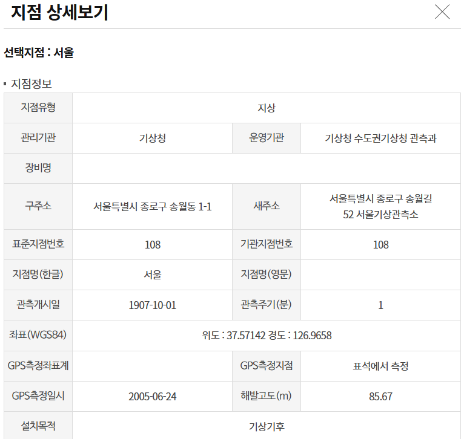
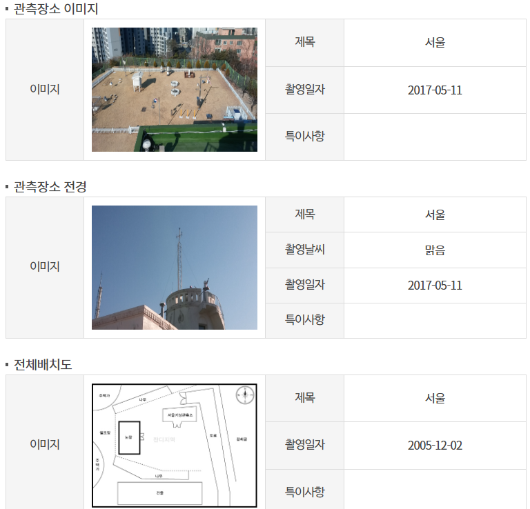
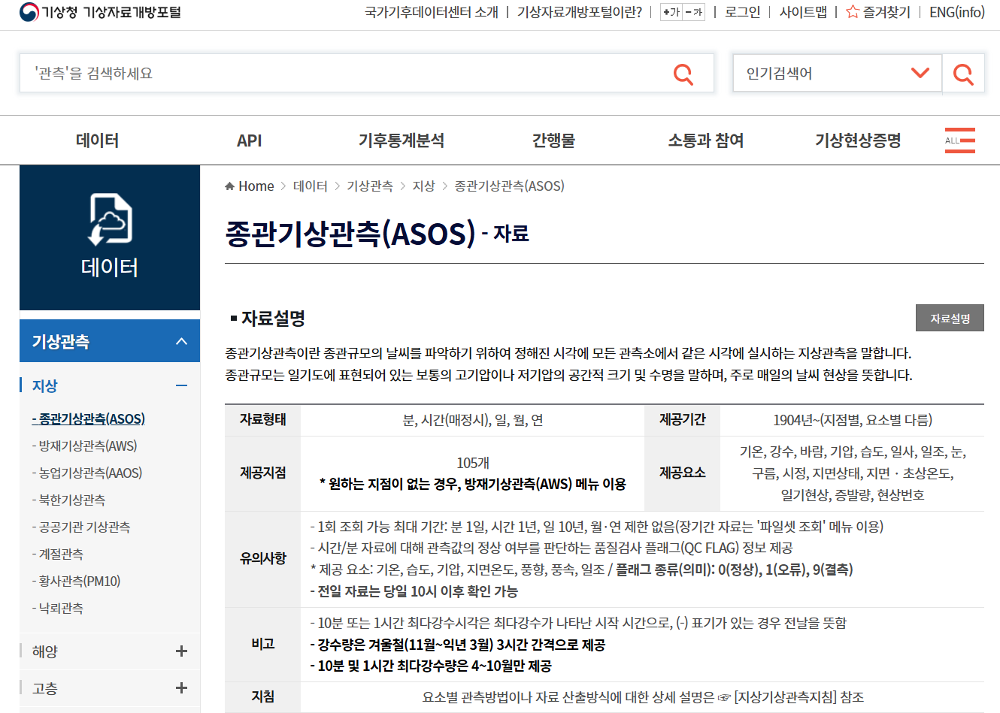
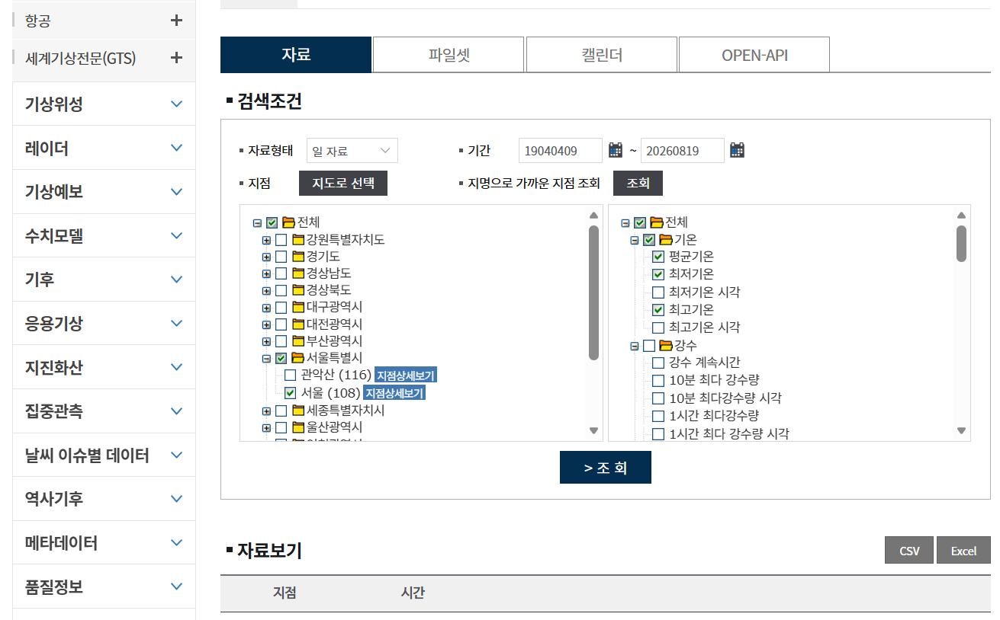

# Data

## 1. Raw Data

The raw dataset is stored in the `data/raw/` directory.

* **Raw File:** `data/raw/dataset_original.csv`
* **Source:** [Korea Meteorological Administration (KMA) Weather Data Service – Automated Synoptic Observing System (ASOS) Data](https://data.kma.go.kr/data/grnd/selectAsosRltmList.do?pgmNo=36)
* **URL:** [data.kma.go.kr](https://data.kma.go.kr/)
* **Download/Collection Date:** 2026-08-20
* **Date Range:** 1907-10-01 ~ 2026-08-19
    - Note: Data from 1950-09-01 to 1953-11-30 is missing due to the Korean War.
* **Observation Station:** Seoul (108)
* **Station Address:** Seoul Weather Station, 52 Songwol-gil, Jongno-gu, Seoul, Republic of Korea
* **License:** Korea Open Government License (KOGL) Type 1 – Free commercial and non-commercial reuse with attribution
* **Dataset Name:** Automated Synoptic Observing System (ASOS) Data (ASOS KMA Dataset)
* **Data Collection / Download Method:** Selected the observation station (Seoul), inquiry period, and meteorological variables (average temperature, minimum temperature, maximum temperature) on the KMA Weather Data Service portal, then downloaded in CSV/Excel format.
* **Key Variables:** Station ID, Date/Time, Average Temperature (`tavg`), Minimum Temperature (`tmin`), Maximum Temperature (`tmax`)

> **KMA:** Korea Meteorological Administration

---

[Observation Station Details]

 

  <table>
    <tr>
      <td align="center">
        
      </td>
      <td align="center">
        
      </td>
    </tr>
  </table>

 

---

[Data Collection Portal Screenshots]

 

  <table>
    <tr>
      <td align="center">
        
      </td>
      <td align="center">
        
      </td>
    </tr>
  </table>

 

---

## 2. Processed Data

The cleaned and transformed dataset is stored in the `data/processed/` directory.

* **Cleaned & Transformed File:** `data/processed/dataset_cleaned.csv`

* **Data Cleaning:**
  * Checked and handled missing values
  * Checked and resolved duplicate records
  * Corrected invalid date formats
  * Inspected and handled anomalous/erroneous values

* **Feature Engineering & Transformation:**
  * Converted date strings to `datetime` format
  * Transformed `dd/mm/yyyy` formatted date records into standardized datetime types, splitting into year (`year`), month (`month`), and day (`day`)
  * Generated day-of-year feature (`day_of_year`) based on observation dates
  * Engineered seasonal year feature (`season_year`) to preserve winter continuity (assigning March–December to the current year and January–February to the preceding year, ensuring winter [December–February] is aggregated under the same reference year)
  * Generated categorical season feature (`season`) based on dates
  * Structured and formatted the dataset for downstream time-series analysis and summer temperature trend modeling

---

## Reference Links

* [KMA Weather Data Service Portal](https://data.kma.go.kr/)
* [Automated Synoptic Observing System (ASOS) Data Query](https://data.kma.go.kr/data/grnd/selectAsosRltmList.do?pgmNo=36)
* [Korea Institute of Energy Research (KIER) Technology Policy Platform: 1931–2022 South Korea Heatwave Days Infographic](https://www.kier.re.kr/tpp/energy/B/view/223?contentsName=info_heat&menuId=MENU00962)
